# NexusERP Database Design

**Project:** NexusERP — multi-tenant SaaS ERP  
**Database:** PostgreSQL  
**Architecture:** Shared database, shared schema, tenant-scoped rows  
**Capacity objective:** 1,000 simultaneously active users  
**Status:** Proposed design; implementation and load-test validation are still required.

## 1. Purpose and design principles

This document defines the proposed database model for NexusERP: identity and tenancy, catalog, inventory, purchasing, sales, invoicing, audit, and reliability tables.

Core principles:

1. Every tenant-owned business row has a non-null `tenant_id`.
2. Application authorization and PostgreSQL Row-Level Security (RLS) both enforce tenant boundaries.
3. Composite foreign keys prevent cross-tenant references.
4. Inventory history is append-only; balances are a transactional projection.
5. Monetary values use `NUMERIC`, never floating point.
6. Related business writes happen in one database transaction.
7. Indexes are chosen from real query patterns and verified with query plans.
8. A modular monolith owns the database initially; do not split it into microservices prematurely.

## 2. High-level entity relationship diagram

```mermaid
erDiagram
    USERS {
        uuid id PK
        citext email UK
        text password_hash
        text display_name
        text status
        timestamptz created_at
        timestamptz updated_at
    }
    TENANTS {
        uuid id PK
        text name
        text slug UK
        text status
        char3 default_currency
        text timezone
        timestamptz created_at
        timestamptz updated_at
    }
    TENANT_MEMBERSHIPS {
        uuid id PK
        uuid tenant_id FK
        uuid user_id FK
        uuid role_id FK
        text status
        timestamptz joined_at
        timestamptz created_at
    }
    ROLES {
        uuid id PK
        uuid tenant_id FK
        text name
        text description
        timestamptz created_at
    }
    PERMISSIONS {
        text code PK
        text description
    }
    ROLE_PERMISSIONS {
        uuid tenant_id FK
        uuid role_id FK
        text permission_code FK
    }
    CATEGORIES {
        uuid id PK
        uuid tenant_id FK
        uuid parent_id FK
        text name
        text description
        timestamptz created_at
    }
    PRODUCTS {
        uuid id PK
        uuid tenant_id FK
        uuid category_id FK
        text sku
        text name
        text description
        text unit_of_measure
        numeric_14_2 unit_price
        numeric_14_2 cost_price
        boolean is_active
        timestamptz created_at
        timestamptz updated_at
    }
    WAREHOUSES {
        uuid id PK
        uuid tenant_id FK
        text code
        text name
        text address
        boolean is_active
        timestamptz created_at
    }
    INVENTORY_BALANCES {
        uuid tenant_id PK, FK
        uuid warehouse_id PK, FK
        uuid product_id PK, FK
        numeric_18_3 quantity_on_hand
        numeric_18_3 quantity_reserved
        timestamptz updated_at
    }
    INVENTORY_MOVEMENTS {
        uuid id PK
        uuid tenant_id FK
        uuid warehouse_id FK
        uuid product_id FK
        text movement_type
        numeric_18_3 quantity_delta
        text reference_type
        uuid reference_id
        text reason
        uuid created_by FK
        timestamptz created_at
    }
    CUSTOMERS {
        uuid id PK
        uuid tenant_id FK
        text code
        text name
        text email
        text phone
        jsonb billing_address
        boolean is_active
        timestamptz created_at
    }
    SUPPLIERS {
        uuid id PK
        uuid tenant_id FK
        text code
        text name
        text email
        text phone
        jsonb address
        boolean is_active
        timestamptz created_at
    }
    PURCHASE_ORDERS {
        uuid id PK
        uuid tenant_id FK
        uuid supplier_id FK
        text order_number
        text status
        timestamptz ordered_at
        timestamptz expected_at
        char3 currency
        numeric_14_2 subtotal
        numeric_14_2 tax_total
        numeric_14_2 total
        uuid created_by FK
        timestamptz created_at
    }
    PURCHASE_ORDER_ITEMS {
        uuid id PK
        uuid tenant_id FK
        uuid purchase_order_id FK
        uuid product_id FK
        numeric_18_3 quantity_ordered
        numeric_18_3 quantity_received
        numeric_14_2 unit_cost
        numeric_14_2 line_total
    }
    GOODS_RECEIPTS {
        uuid id PK
        uuid tenant_id FK
        uuid purchase_order_id FK
        uuid warehouse_id FK
        text receipt_number
        text status
        timestamptz received_at
        uuid received_by FK
    }
    GOODS_RECEIPT_ITEMS {
        uuid id PK
        uuid tenant_id FK
        uuid goods_receipt_id FK
        uuid purchase_order_item_id FK
        uuid product_id FK
        numeric_18_3 quantity_received
    }
    SALES_ORDERS {
        uuid id PK
        uuid tenant_id FK
        uuid customer_id FK
        text order_number
        text status
        timestamptz ordered_at
        char3 currency
        numeric_14_2 subtotal
        numeric_14_2 tax_total
        numeric_14_2 discount_total
        numeric_14_2 total
        uuid created_by FK
        timestamptz created_at
    }
    SALES_ORDER_ITEMS {
        uuid id PK
        uuid tenant_id FK
        uuid sales_order_id FK
        uuid product_id FK
        text sku_snapshot
        text description_snapshot
        numeric_18_3 quantity
        numeric_14_2 unit_price
        numeric_14_2 discount
        numeric_14_2 tax
        numeric_14_2 line_total
    }
    INVOICES {
        uuid id PK
        uuid tenant_id FK
        uuid sales_order_id FK
        text invoice_number
        text status
        timestamptz issued_at
        timestamptz due_at
        char3 currency
        numeric_14_2 subtotal
        numeric_14_2 tax_total
        numeric_14_2 total
        timestamptz created_at
    }
    AUDIT_LOGS {
        uuid id PK
        uuid tenant_id FK
        uuid actor_user_id FK
        text action
        text entity_type
        uuid entity_id
        jsonb metadata
        text request_id
        timestamptz created_at
    }
    IDEMPOTENCY_KEYS {
        uuid tenant_id PK, FK
        text idempotency_key PK
        text request_hash
        integer response_status
        jsonb response_body
        timestamptz created_at
        timestamptz expires_at
    }
    OUTBOX_EVENTS {
        uuid id PK
        uuid tenant_id FK
        text event_type
        text aggregate_type
        uuid aggregate_id
        jsonb payload
        timestamptz created_at
        timestamptz published_at
        integer attempt_count
        text last_error
    }

    USERS ||--o{ TENANT_MEMBERSHIPS : joins
    TENANTS ||--o{ TENANT_MEMBERSHIPS : has
    TENANTS ||--o{ ROLES : defines
    ROLES ||--o{ ROLE_PERMISSIONS : grants
    PERMISSIONS ||--o{ ROLE_PERMISSIONS : assigned
    ROLES ||--o{ TENANT_MEMBERSHIPS : assigned_to

    TENANTS ||--o{ CATEGORIES : owns
    CATEGORIES o|--o{ CATEGORIES : parent_of
    CATEGORIES o|--o{ PRODUCTS : classifies
    TENANTS ||--o{ PRODUCTS : owns
    TENANTS ||--o{ WAREHOUSES : owns
    PRODUCTS ||--o{ INVENTORY_BALANCES : stocked
    WAREHOUSES ||--o{ INVENTORY_BALANCES : contains
    PRODUCTS ||--o{ INVENTORY_MOVEMENTS : moved
    WAREHOUSES ||--o{ INVENTORY_MOVEMENTS : records

    TENANTS ||--o{ CUSTOMERS : owns
    TENANTS ||--o{ SUPPLIERS : owns
    SUPPLIERS ||--o{ PURCHASE_ORDERS : receives
    PURCHASE_ORDERS ||--|{ PURCHASE_ORDER_ITEMS : contains
    PURCHASE_ORDERS ||--o{ GOODS_RECEIPTS : received_through
    GOODS_RECEIPTS ||--|{ GOODS_RECEIPT_ITEMS : contains
    PRODUCTS ||--o{ PURCHASE_ORDER_ITEMS : ordered
    PRODUCTS ||--o{ GOODS_RECEIPT_ITEMS : received

    CUSTOMERS ||--o{ SALES_ORDERS : places
    SALES_ORDERS ||--|{ SALES_ORDER_ITEMS : contains
    PRODUCTS ||--o{ SALES_ORDER_ITEMS : sold
    SALES_ORDERS ||--o{ INVOICES : invoiced

    TENANTS ||--o{ AUDIT_LOGS : records
    TENANTS ||--o{ IDEMPOTENCY_KEYS : scopes
    TENANTS ||--o{ OUTBOX_EVENTS : publishes
```



**How to read the diagram:** Each entity box now lists its columns and PostgreSQL data types. `PK` means primary key, `FK` means foreign key, and `UK` means unique key. A field marked both `PK, FK` participates in a composite primary key and is also a foreign key. `numeric_14_2` means `NUMERIC(14,2)`; `numeric_18_3` means `NUMERIC(18,3)`; `char3` means `CHAR(3)`.

The diagram is conceptual. Every relationship between tenant-owned records must also include tenant ownership in the actual database constraints. Some relationships are composite (for example, tenant plus product ID); the entity diagram labels the participating columns, while the detailed sections below define the required composite constraints.

## 3. Multi-tenancy strategy

### Shared schema

All companies share the same PostgreSQL database and tables. Tenant-owned rows are distinguished by `tenant_id`.

```text
products
+----------------------+----------------------+------------+
| id                   | tenant_id            | sku        |
+----------------------+----------------------+------------+
| product-uuid-1       | company-uuid-A       | SKU-001    |
| product-uuid-2       | company-uuid-B       | SKU-001    |
+----------------------+----------------------+------------+
```

The same SKU can exist in different companies, so use `UNIQUE (tenant_id, sku)`, not a global unique constraint.

### Global and tenant-owned records

**Global/platform records**
- `users`: one login identity per person.
- `permissions`: canonical permission codes, if centrally defined.
- Platform configuration and internal operational data.

**Tenant-owned records**
- `tenants`, memberships, tenant roles and settings.
- Products, categories, warehouses.
- Customers and suppliers.
- Purchase orders, receipts, sales orders, invoices.
- Inventory balances and movements.
- Audit logs, idempotency keys, outbox events.

A user can belong to multiple tenants. A `tenant_memberships` row assigns that user a role within one tenant. Never trust a tenant ID supplied by the browser without checking the authenticated user's active membership.

## 4. Entity and table details

Types below are PostgreSQL types. UUID generation can use the application's UUID library or a database UUID function.

### 4.1 Identity and tenant administration

#### `users`
Global user identity.

**Why it is needed:** Provides a single login identity that can access one or more company workspaces.

| Column | Type | Meaning |
|---|---|---|
| `id` | UUID PK | User ID |
| `email` | CITEXT or normalized TEXT | Globally unique login email |
| `password_hash` | TEXT | Password hash only |
| `display_name` | TEXT | Display name |
| `status` | TEXT | active, disabled, pending |
| `created_at` | TIMESTAMPTZ | Creation time |
| `updated_at` | TIMESTAMPTZ | Last update |

Normalize email consistently and enforce uniqueness. Never store plaintext passwords.

#### `tenants`
A company workspace.

**Why it is needed:** Keeps each company's settings and business data isolated within the shared database.

| Column | Type | Meaning |
|---|---|---|
| `id` | UUID PK | Tenant ID |
| `name` | TEXT | Company name |
| `slug` | TEXT UNIQUE | URL-friendly identifier |
| `status` | TEXT | trial, active, suspended, closed |
| `default_currency` | CHAR(3) | ISO currency code |
| `timezone` | TEXT | IANA timezone |
| `created_at` | TIMESTAMPTZ | Creation time |
| `updated_at` | TIMESTAMPTZ | Last update |

#### `tenant_memberships`
Connects users to tenants.

**Why it is needed:** Records which users belong to each company and their tenant-specific role and membership status.

| Column | Type | Meaning |
|---|---|---|
| `id` | UUID PK | Membership ID |
| `tenant_id` | UUID FK | Company |
| `user_id` | UUID FK | User |
| `role_id` | UUID | Tenant role |
| `status` | TEXT | invited, active, suspended |
| `joined_at` | TIMESTAMPTZ nullable | Accepted time |
| `created_at` | TIMESTAMPTZ | Creation time |

Constraints:
- `UNIQUE (tenant_id, user_id)`.
- Index `(user_id, status)` to list a user's active companies.
- Use a composite foreign key `(tenant_id, role_id)` to ensure the role belongs to the same tenant.

#### `roles`, `permissions`, `role_permissions`
Roles are tenant-scoped. Permission codes can be a global catalogue, such as `products.read`, `inventory.adjust`, `sales.confirm`, and `tenant.members.manage`.

- `roles`: `id`, `tenant_id`, `name`, `description`, `created_at`.
- `permissions`: `code` (PK), `description`.
- `role_permissions`: `tenant_id`, `role_id`, `permission_code`.

**Why it is needed:** `roles` groups tenant-specific access rights.

**Why it is needed:** `permissions` defines the individual actions that can be granted.

**Why it is needed:** `role_permissions` assigns permissions to tenant-specific roles.

Constraints:
- `UNIQUE (tenant_id, name)` for roles.
- `UNIQUE (tenant_id, role_id, permission_code)` for assignments.
- A role-permission assignment must reference a role in the same tenant.

Suggested roles: owner, administrator, inventory manager, sales representative, purchasing user, and read-only user.

### 4.2 Product catalogue

#### `categories`
**Why it is needed:** Organizes a tenant's products into a browsable, optionally nested catalogue.

- `id` UUID PK
- `tenant_id` UUID NOT NULL
- `parent_id` UUID NULL
- `name` TEXT NOT NULL
- `description` TEXT NULL
- `created_at` TIMESTAMPTZ

Use a composite self-reference `(tenant_id, parent_id)` so a category cannot have a parent from another tenant.

#### `products`

**Why it is needed:** Stores the tenant's sellable or stockable items and their catalogue, pricing, and unit details.

| Column | Type | Meaning |
|---|---|---|
| `id` | UUID PK | Product |
| `tenant_id` | UUID NOT NULL | Owner |
| `category_id` | UUID nullable | Category |
| `sku` | TEXT | Tenant-unique stock code |
| `name` | TEXT | Product name |
| `description` | TEXT nullable | Description |
| `unit_of_measure` | TEXT | piece, kg, box, etc. |
| `unit_price` | NUMERIC(14,2) | Selling price |
| `cost_price` | NUMERIC(14,2) nullable | Cost basis |
| `is_active` | BOOLEAN | Availability |
| `created_at` | TIMESTAMPTZ | Creation time |
| `updated_at` | TIMESTAMPTZ | Last update |

Constraints:
- `UNIQUE (tenant_id, id)` to support composite references.
- `UNIQUE (tenant_id, sku)`.
- `CHECK (unit_price >= 0)`.
- Composite FK `(tenant_id, category_id)` to categories.

Do not delete products referenced by historical transactions; deactivate them instead.

### 4.3 Warehouses and inventory

#### `warehouses`
**Why it is needed:** Identifies the tenant's physical or logical locations where inventory is stored.

- `id` UUID PK
- `tenant_id` UUID NOT NULL
- `code` TEXT NOT NULL
- `name` TEXT NOT NULL
- `address` TEXT NULL
- `is_active` BOOLEAN NOT NULL
- `created_at` TIMESTAMPTZ

Constraint: `UNIQUE (tenant_id, code)`.

#### `inventory_balances`
One row per tenant, warehouse, and product.

**Why it is needed:** Provides the current on-hand and reserved quantity for each product at each warehouse without recalculating the full movement history.

| Column | Type | Meaning |
|---|---|---|
| `tenant_id` | UUID | Tenant |
| `warehouse_id` | UUID | Warehouse |
| `product_id` | UUID | Product |
| `quantity_on_hand` | NUMERIC(18,3) | Physical quantity |
| `quantity_reserved` | NUMERIC(18,3) | Reserved quantity, if reservation is used |
| `updated_at` | TIMESTAMPTZ | Last update |

Primary key: `(tenant_id, warehouse_id, product_id)`.

Checks:
- Quantities are non-negative if negative inventory is not allowed.
- `quantity_reserved <= quantity_on_hand` if reservation is implemented.

Available stock is `quantity_on_hand - quantity_reserved`.

#### `inventory_movements`
Append-only record of every stock change.

**Why it is needed:** Preserves an auditable history of stock increases and decreases and the business events that caused them.

| Column | Type | Meaning |
|---|---|---|
| `id` | UUID PK | Movement ID |
| `tenant_id` | UUID | Tenant |
| `warehouse_id` | UUID | Warehouse |
| `product_id` | UUID | Product |
| `movement_type` | TEXT | receipt, sale, return, adjustment, transfer |
| `quantity_delta` | NUMERIC(18,3) | Signed change |
| `reference_type` | TEXT | Source type |
| `reference_id` | UUID nullable | Source record |
| `reason` | TEXT nullable | Adjustment reason |
| `created_by` | UUID nullable | User/system actor |
| `created_at` | TIMESTAMPTZ | Event time |

Useful indexes:
- `(tenant_id, product_id, created_at DESC)`.
- `(tenant_id, warehouse_id, created_at DESC)`.
- `(tenant_id, reference_type, reference_id)`.

The movement ledger preserves history. The balance table is a fast projection. Update the movement and balance in the same transaction. Correct errors with compensating movements, not edits to old movements.

### 4.4 Customers and suppliers

#### `customers`
**Why it is needed:** Stores customer identity and contact details for sales orders and invoicing.

- `id` UUID PK
- `tenant_id` UUID NOT NULL
- `code` TEXT nullable
- `name` TEXT NOT NULL
- `email`, `phone` TEXT nullable
- `billing_address` JSONB or normalized address fields
- `is_active` BOOLEAN
- `created_at` TIMESTAMPTZ

#### `suppliers`
Similar to customers, with supplier-specific contact and payment terms as required.

**Why it is needed:** Stores supplier details needed to create and manage purchase orders and incoming deliveries.

Use tenant-scoped uniqueness for codes. If codes are nullable, use a partial unique index or make them mandatory.

### 4.5 Purchasing

#### `purchase_orders`
**Why it is needed:** Records what a tenant orders from a supplier, including order status, expected delivery, and totals.

- `id` UUID PK
- `tenant_id` UUID NOT NULL
- `supplier_id` UUID NOT NULL
- `order_number` TEXT NOT NULL
- `status` TEXT: draft, submitted, approved, partially_received, received, cancelled
- `ordered_at`, `expected_at` TIMESTAMPTZ
- `currency` CHAR(3)
- `subtotal`, `tax_total`, `total` NUMERIC(14,2)
- `created_by` UUID
- `created_at` TIMESTAMPTZ

Constraints: `UNIQUE (tenant_id, order_number)` and composite supplier FK.

#### `purchase_order_items`
**Why it is needed:** Stores the products, quantities, and costs that make up each purchase order.

- `id` UUID PK
- `tenant_id` UUID NOT NULL
- `purchase_order_id` UUID NOT NULL
- `product_id` UUID NOT NULL
- `quantity_ordered`, `quantity_received` NUMERIC(18,3)
- `unit_cost`, `line_total` NUMERIC(14,2)

Checks: ordered quantity is positive; received quantity is non-negative and normally cannot exceed ordered quantity.

#### `goods_receipts` and `goods_receipt_items`
A purchase order can be received in multiple deliveries.

`goods_receipts` stores tenant, purchase order, warehouse, receipt number, status, received time, and receiving actor.

**Why it is needed:** `goods_receipts` records each delivery against a purchase order, including its warehouse, status, and receiving actor.

`goods_receipt_items` stores the purchase-order line, product, and quantity received. Posting a receipt inserts receipt records, inventory movements, and balance changes in one transaction.

**Why it is needed:** `goods_receipt_items` records which products and quantities were received in each delivery.

### 4.6 Sales and invoicing

#### `sales_orders`
**Why it is needed:** Records a customer's requested purchase, its lifecycle status, and order-level financial totals.

- `id` UUID PK
- `tenant_id` UUID NOT NULL
- `customer_id` UUID NOT NULL
- `order_number` TEXT NOT NULL
- `status` TEXT: draft, confirmed, fulfilled, cancelled
- `ordered_at` TIMESTAMPTZ
- `currency` CHAR(3)
- `subtotal`, `tax_total`, `discount_total`, `total` NUMERIC(14,2)
- `created_by` UUID
- `created_at` TIMESTAMPTZ

Constraint: `UNIQUE (tenant_id, order_number)` and composite customer FK.

#### `sales_order_items`
Stores tenant, order, product, quantity, unit price, discount, tax, and line total. Store a snapshot of SKU/description and unit price at sale time so later product edits cannot rewrite historical sales.

**Why it is needed:** Captures each product and its sale-time terms so the order remains accurate even if catalogue data changes.

#### `invoices`
**Why it is needed:** Records amounts billed to customers and tracks each invoice's issue, due, and payment status.

- `id` UUID PK
- `tenant_id` UUID NOT NULL
- `sales_order_id` UUID NOT NULL
- `invoice_number` TEXT NOT NULL
- `status` TEXT: draft, issued, paid, void, overdue
- `issued_at`, `due_at` TIMESTAMPTZ nullable
- `currency` CHAR(3)
- `subtotal`, `tax_total`, `total` NUMERIC(14,2)
- `created_at` TIMESTAMPTZ

Constraint: `UNIQUE (tenant_id, invoice_number)`. If only one invoice per order is supported, also make `(tenant_id, sales_order_id)` unique. Multiple invoices per order require a one-to-many relationship.

Payments, credit notes, and accounting journals are not part of the initial inventory/sales MVP unless explicitly added to scope.

### 4.7 Operational and reliability tables

#### `audit_logs`
Records important actions: role changes, product edits, stock adjustments, order confirmation, invoice issue, and tenant settings changes.

**Why it is needed:** Provides a traceable record of important user and system actions for accountability and investigation.

Suggested fields: `id`, `tenant_id`, `actor_user_id`, `action`, `entity_type`, `entity_id`, `metadata JSONB`, `request_id`, `created_at`.

Do not put passwords, tokens, or unnecessary personal data in metadata.

#### `idempotency_keys`
Prevents retries from creating duplicate receipts, invoices, or stock movements.

**Why it is needed:** Lets the application safely retry requests without creating duplicate business records or stock changes.

Suggested fields: `tenant_id`, `idempotency_key`, `request_hash`, `response_status`, `response_body JSONB` or result reference, `created_at`, `expires_at`.

Constraint: `UNIQUE (tenant_id, idempotency_key)`. Reusing a key with a different request body must be rejected.

#### `outbox_events`
Stores events in the same transaction as the business change that produced them.

**Why it is needed:** Reliably queues business events for asynchronous processing without losing them when a transaction commits.

Suggested fields: `id`, `tenant_id`, `event_type`, `aggregate_type`, `aggregate_id`, `payload JSONB`, `created_at`, `published_at`, `attempt_count`, `last_error`.

Workers process unpublished events and mark them complete. Processing must be idempotent because a worker can crash and retry.

## 5. Composite keys and tenant-safe relationships

Tenant-owned child records should reference tenant-owned parents with composite foreign keys. Example:

```sql
CREATE TABLE products (
    id UUID NOT NULL,
    tenant_id UUID NOT NULL REFERENCES tenants(id),
    sku TEXT NOT NULL,
    name TEXT NOT NULL,
    unit_price NUMERIC(14,2) NOT NULL CHECK (unit_price >= 0),
    created_at TIMESTAMPTZ NOT NULL DEFAULT now(),
    PRIMARY KEY (id),
    UNIQUE (tenant_id, id),
    UNIQUE (tenant_id, sku)
);

CREATE TABLE sales_order_items (
    id UUID PRIMARY KEY,
    tenant_id UUID NOT NULL,
    sales_order_id UUID NOT NULL,
    product_id UUID NOT NULL,
    quantity NUMERIC(18,3) NOT NULL CHECK (quantity > 0),
    unit_price NUMERIC(14,2) NOT NULL CHECK (unit_price >= 0),
    FOREIGN KEY (tenant_id, product_id)
        REFERENCES products (tenant_id, id)
);
```

Apply the same pattern to order/customer, receipt/order, balance/product, balance/warehouse, and membership/role relationships. A composite FK makes cross-tenant references invalid even if a handler accidentally supplies a foreign UUID.

## 6. Indexing strategy

Start with indexes that match common tenant-scoped queries:

```sql
CREATE INDEX products_tenant_name_idx
    ON products (tenant_id, name);

CREATE INDEX sales_orders_tenant_created_idx
    ON sales_orders (tenant_id, created_at DESC);

CREATE INDEX sales_orders_tenant_status_created_idx
    ON sales_orders (tenant_id, status, created_at DESC);

CREATE INDEX inventory_movements_tenant_product_time_idx
    ON inventory_movements (tenant_id, product_id, created_at DESC);

CREATE INDEX outbox_unpublished_idx
    ON outbox_events (created_at)
    WHERE published_at IS NULL;
```

These are examples, not a mandate to create every index. Indexes cost storage and slow writes. Inspect representative query plans with `EXPLAIN (ANALYZE, BUFFERS)` before adding or changing indexes. Use cursor pagination with stable ordering for large lists.

## 7. PostgreSQL Row-Level Security

Enable RLS on every tenant-owned table. Example policy for `products`:

```sql
ALTER TABLE products ENABLE ROW LEVEL SECURITY;
ALTER TABLE products FORCE ROW LEVEL SECURITY;

CREATE POLICY products_tenant_policy
ON products
USING (
    tenant_id = current_setting('app.current_tenant', true)::uuid
)
WITH CHECK (
    tenant_id = current_setting('app.current_tenant', true)::uuid
);
```

At the beginning of each transaction, set tenant context transaction-locally:

```sql
SELECT set_config('app.current_tenant', $1, true);
```

The final `true` is important: it makes the setting local to the transaction, preventing tenant context from leaking when pgxpool reuses a connection.

Production rules:
- Runtime DB role must not own protected tables or bypass RLS.
- Use a separate migration/owner role.
- Set tenant context in every transaction that accesses tenant data.
- Apply policies consistently to all tenant-owned tables.
- Test missing context, invalid context, rollbacks, connection reuse, and worker execution.
- RLS does not replace membership and permission checks in the application.

## 8. Critical transaction workflows

### Posting a goods receipt

Within one transaction:
1. Set tenant context.
2. Lock the purchase order and relevant lines.
3. Validate state and quantities.
4. Insert receipt and receipt items.
5. Insert positive inventory movements.
6. Update/upsert inventory balances.
7. Update received quantities and purchase-order status.
8. Insert audit/outbox records if required.
9. Commit.

If any step fails, roll back all of them.

### Confirming a sales order

Within one transaction:
1. Set tenant context.
2. Lock the order and relevant inventory balance rows.
3. Lock multiple balance rows in deterministic order to reduce deadlocks.
4. Verify available quantities.
5. Deduct stock with guarded updates.
6. Insert negative inventory movements.
7. Create invoice and update order state.
8. Insert audit/outbox records.
9. Commit.

Example guarded update:

```sql
UPDATE inventory_balances
SET quantity_on_hand = quantity_on_hand - $1,
    updated_at = now()
WHERE tenant_id = $2
  AND warehouse_id = $3
  AND product_id = $4
  AND quantity_on_hand - quantity_reserved >= $1;
```

Check affected rows. If no row was updated, stock is unavailable (or the balance row is missing); do not confirm the order or create its invoice.

### Cancellation

Do not delete historical movements. Transition the order to its valid cancelled state and add compensating stock movements if stock must be returned. Record actor, timestamp, and reason.

## 9. Data lifecycle

- Deactivate products, customers, and suppliers that are referenced by history rather than deleting them.
- Do not hard-delete posted inventory movements or issued invoices through normal workflows.
- Avoid broad cascading deletes across financial and inventory history.
- Define tenant export, closure, retention, and deletion procedures.
- If personal data must be erased, use a controlled anonymization process that preserves required business records.

## 10. Performance and 1,000-user target

These are proposed validation targets, not guaranteed capacity:

| Metric | Initial target |
|---|---:|
| Simultaneously active users | 1,000 |
| Sustained throughput | 200 requests/second |
| Short burst throughput | 500 requests/second |
| Ordinary indexed read latency | p95 below 300 ms |
| Ordinary write latency | p95 below 500 ms |

A starting benchmark environment could use two Go API instances (2–4 vCPU and 2–4 GB RAM each) and a PostgreSQL primary around 4 vCPU / 16 GB RAM. This is only a starting test configuration. Actual capacity depends on workload, data distribution, query quality, storage IOPS, and connection behavior.

Database performance rules:
- Use bounded pgxpool limits; calculate the total across API replicas and workers.
- Keep transactions short; do not make network calls inside them.
- Avoid N+1 queries and fetch only required columns.
- Monitor slow queries, lock waits, deadlocks, pool saturation, CPU, memory, and IOPS.
- Add a read replica only for workloads that can tolerate replication lag.
- Do not partition tables until measurements and growth justify it.
- Use k6 to test a realistic mix of dashboard reads, searches, inventory checks, and business writes. Record achieved RPS, p50/p95/p99 latency, error rate, and DB metrics.

## 11. Suggested migration order

1. Users, tenants, memberships.
2. Roles, permissions, role-permission assignments.
3. Tenant settings and RLS policies.
4. Categories and products.
5. Warehouses, inventory balances, inventory movements.
6. Customers and suppliers.
7. Purchase orders and items.
8. Goods receipts and receipt items.
9. Sales orders and items.
10. Invoices.
11. Audit logs, idempotency keys, outbox events.
12. Additional indexes based on measured query plans.

Keep migrations small and reviewable. Test migration application against real PostgreSQL. Do not perform destructive changes without a data migration and rollback plan.

## 12. Database test checklist

### Tenant isolation
- [ ] Tenant A cannot read, update, or delete Tenant B records.
- [ ] Cross-tenant foreign keys are rejected.
- [ ] RLS denies access when tenant context is missing.
- [ ] Pooled connections do not retain a previous tenant context.
- [ ] Background jobs set the correct tenant context.
- [ ] Reports and exports are tenant-scoped.

### Business correctness
- [ ] Every stock balance change has a corresponding movement.
- [ ] Concurrent sales cannot oversell inventory.
- [ ] Partial receipts update only quantities actually received.
- [ ] Idempotent retries do not duplicate receipts, invoices, or movements.
- [ ] Failed order confirmation rolls back all related writes.
- [ ] Historical sale prices remain unchanged after product price edits.
- [ ] Cancellation uses compensating history.

### Performance and operations
- [ ] Common queries use appropriate indexes.
- [ ] Query plans are inspected with representative data.
- [ ] Pool saturation and lock contention are measured.
- [ ] Load tests report throughput, latency percentiles, and errors.
- [ ] Backup restoration is tested.

## 13. Decisions to revisit

These are intentionally deferred until product requirements are clearer:
- Multi-currency exchange-rate snapshots.
- Jurisdiction-specific tax rules.
- Stock reservation before order confirmation.
- Split invoices, payments, credit notes, and accounting journals.
- Tenant custom fields.
- Dedicated databases for exceptionally large tenants.
- Partitioning high-volume inventory and audit tables.

## 14. Summary

NexusERP uses shared-schema PostgreSQL tenancy. `tenant_id` is part of every tenant-owned row and is reinforced by composite foreign keys and RLS. Inventory movements preserve history while balances support fast reads. Purchasing and sales operations use transactions, guarded stock updates, and idempotency to remain correct under concurrent requests.

Implement this model incrementally, test isolation using the production-like database role and connection pool, and publish measured load-test results before claiming the 1,000-active-user target is achieved.
